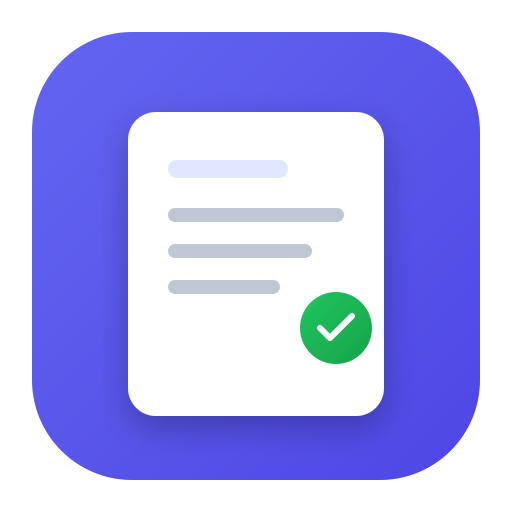
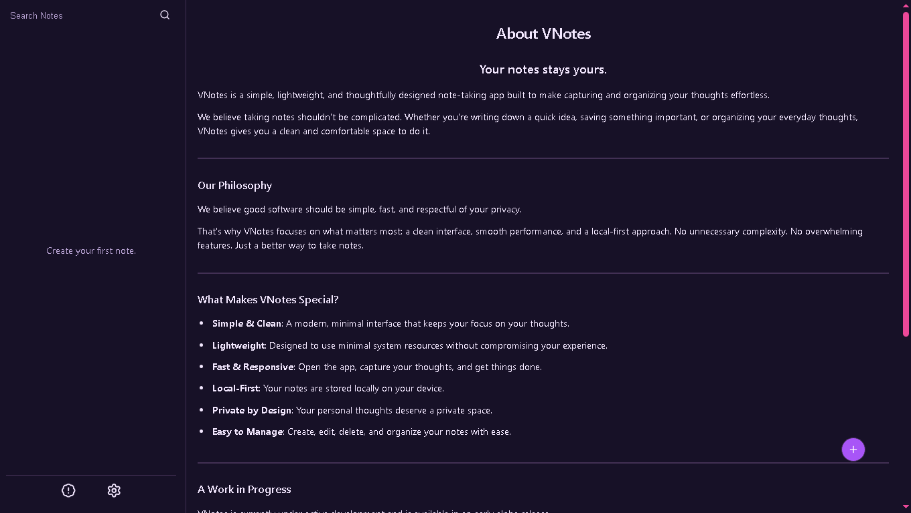
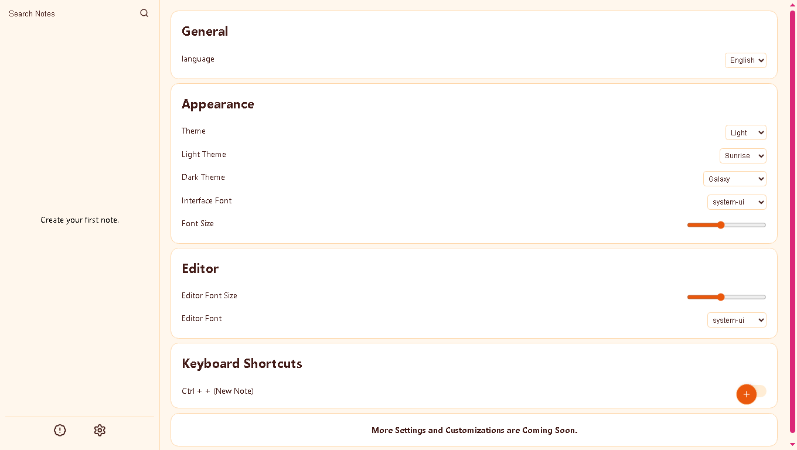
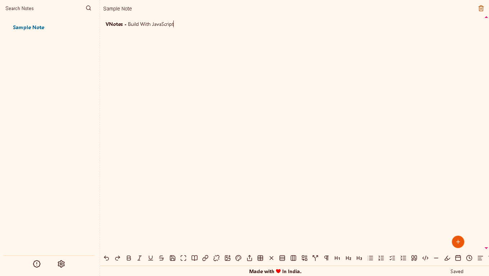

<h1 align="center">VNotes</h1>

<p align="center">
  
</p>

<h3 align="center">Your notes stay yours.</h3>

<p align="center">
  A lightweight, fast, and privacy-focused notes application.
  <br />
  Open source. Local-first. No accounts. No cloud storage.
</p>

<p align="center">
  <a href="https://github.com/vishu-coder-web/vnotes">GitHub Repository</a> •
  <a href="https://vnotes-vishu.vercel.app/">Try Demo</a> •
  <a href="https://github.com/vishu-coder-web/vnotes/releases">Download</a>
</p>

<p align="center">
  <strong>v0.1.0-alpha</strong> · First Major Pre-release
</p>

---

## ⚠️ Important: Pre-release Software

VNotes is currently in its **early alpha stage.**

This release is intended for testing and early feedback. You may encounter bugs, unexpected behavior, incomplete features, and breaking changes.

- Some features may not work as expected.
- Features and UI may change in future releases.
- Data loss is possible during development.
- Do not rely on this release as the sole storage location for important notes.
- Always maintain backups of your notes.

Use at your own risk. VNotes is not yet considered stable production software.

---

## What is VNotes?

VNotes is a modern, lightweight notes application built with a focus on simplicity, performance, and privacy.

It provides a rich-text editing experience while keeping resource consumption low.

Your notes belong to you. That's the philosophy behind VNotes.

Unlike cloud-dependent note-taking applications, VNotes follows a local-first approach. Your notes are stored directly on your device using IndexedDB.

No accounts. No subscriptions. No cloud storage.

Just open VNotes and start writing.

## Features

### Currently available

- Rich-text editing – A feature-rich editor with various formatting options.
- Lightweight – Designed to keep RAM usage low.
- Fast performance – A responsive and smooth user experience.
- Autosave – Your changes are automatically saved.
- Search – Find your notes quickly.
- Local-first storage – Notes are stored locally using IndexedDB.
- JSON Import & Export – Import and export your notes in JSON format.
- No account required – Open the application and start writing.

## Future development

VNotes is actively being developed. More features, improvements, and editor capabilities are planned.

## Privacy & Data Ownership

Privacy isn't an optional feature in VNotes. It's part of its core philosophy.

- Your notes are stored locally on your device.
- IndexedDB is used for local data storage.
- No cloud storage or cloud synchronization.
- No account or registration required.
- No dependence on a cloud service to access your notes.

VNotes is designed to be serverless and local-first.

**Your notes stays yours.**

## Platforms

VNotes is primarily a **web application.**

Browser support targets modern browsers. If you encounter compatibility problems, please report them through GitHub Issues.

## Getting Started

### Use VNotes Online

Visit the VNotes demo:

[Open VNotes Demo](https://vnotes-vishu.vercel.app/)

No registration required.

### Run from Source

Make sure you have Node.js and npm installed.

#### Clone the repository:

```bash
git clone https://github.com/vishu-coder-web/vnotes.git
cd vnotes
```

##### Install dependencies:

```bash
npm install
```

#### Start the Vite development server:

```bash
npm run dev
```

#### To create a production build:

```bash
npm run build
```

Refer to the repository for any additional platform-specific build instructions.

## Screenshots

Screenshots of VNotes are available in the **"public/" directory.**






## Technology Stack

VNotes is built using modern web technologies.

| Technology | Purpose |
| --- | --- |
| JavaScript | Main programming language |
| Preact | UI framework |
| Signals | Reactive state management |
| ProseKit | Rich-text editing |
| Split.js | Resizable layouts |
| Dexie.js | IndexedDB database management |
| Vite | Development and build tooling |

## Contributing

Contributions from human developers are welcome!

### You can contribute by:

- Reporting bugs.
- Suggesting features.
- Improving documentation.
- Submitting pull requests.
- Helping improve performance and usability.

### Contribution Guidelines

1. Check existing GitHub Issues before opening a new one.
2. Describe your proposed changes clearly.
3. Keep contributions focused and maintainable.
4. Submit your changes through a Pull Request.

Human contributions only. AI-generated code contributions are not accepted.

## Repository:

https://github.com/vishu-coder-web/vnotes

## License

VNotes is open source and licensed under the GNU General Public License v3.0.

See the "LICENSE" file in the repository for the complete license terms.

## Author

**Vishu Coder**

**GitHub**: [@vishu-coder-web](https://github.com/vishu-coder-web)

VNotes is independently developed and maintained by Vishu Coder.

---

## Authorship & Development Declaration

This README.md was written by **ChatGPT**.

VNotes is a **human-developed software project**. Its development is carried out by a human developer, not through AI-generated application development.

---

<p align="center">
  <strong>VNotes — Your notes stays yours.</strong>
  <br />
  Made with care by Vishu Coder.
</p>